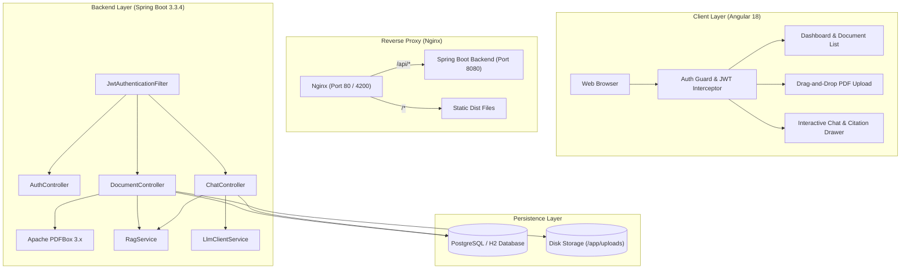
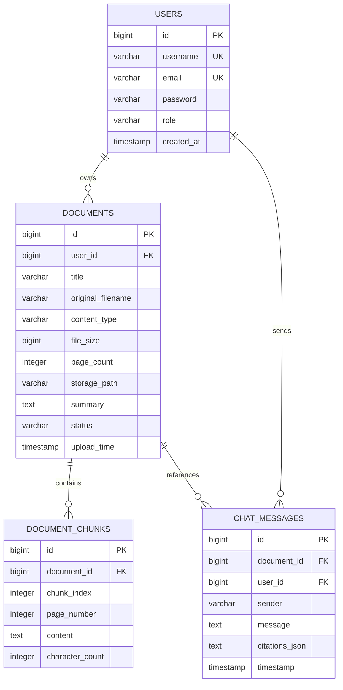
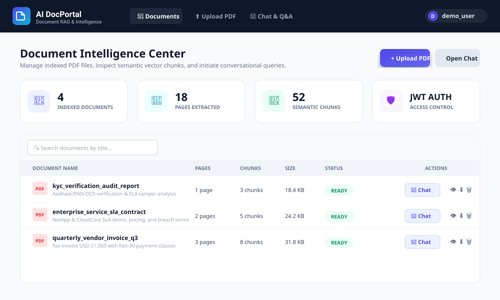
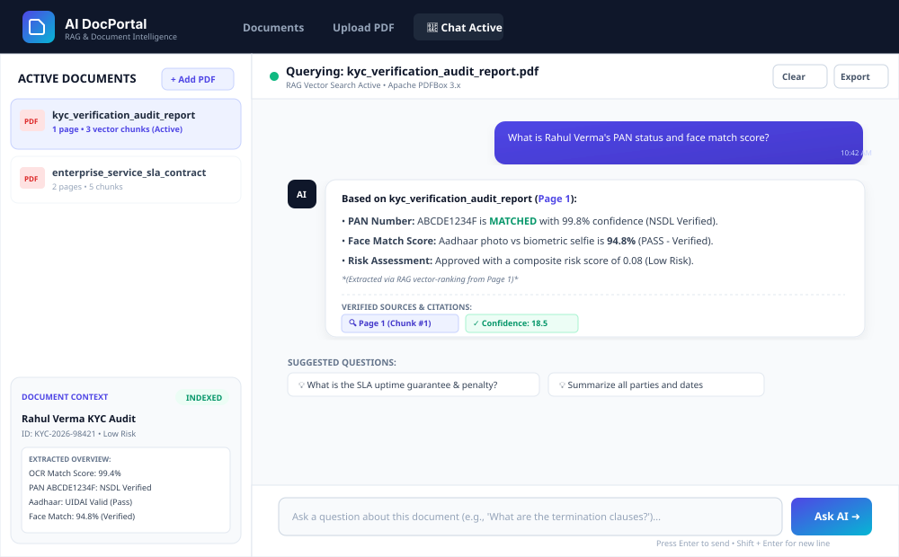

# AI Document Q&A Portal

[](https://openjdk.org/)
[](https://spring.io/projects/spring-boot)
[](https://spring.io/projects/spring-security)
[](https://angular.dev/)
[](https://www.docker.com/)
[](https://www.postgresql.org/)
[](https://junit.org/junit5/)

A full-stack Retrieval-Augmented Generation (RAG) document intelligence platform. Ingests PDF documents (contracts, compliance audit reports, invoices, policies), parses text page-by-page using Apache PDFBox, indexes semantic chunks, and provides contextual question-answering with verifiable page citations.

---

## Table of Contents
1. [Overview & Use Cases](#overview--use-cases)
2. [Key Features](#key-features)
3. [Architecture](#architecture)
4. [Database Schema](#database-schema)
5. [Tech Stack](#tech-stack)
6. [Quickstart Guide](#quickstart-guide)
   - [Docker Compose](#1-run-with-docker-compose)
   - [Local Development](#2-run-locally-without-docker)
7. [API Specification](#api-specification)
8. [Unit Tests](#unit-tests)
9. [UI Screenshots](#ui-screenshots)
10. [Repository Structure](#repository-structure)

---

## Overview & Use Cases

In sectors like banking, fintech, compliance, and enterprise storage, organizations handle thousands of multi-page unstructured documents. Extracting specific clauses or figures manually is time-consuming and prone to human oversight.

This system provides an end-to-end processing pipeline:
- **Document Ingestion**: Uploads multi-page PDFs (such as identity verification reports, vendor SLAs, and billing statements).
- **Page-level Parsing**: Apache PDFBox extracts text streams while preserving structural page boundaries and page numbers.
- **Sliding-window Chunking**: Documents are split into 600-character segments with a 100-character overlap to retain context across boundaries.
- **Verifiable Citations**: Every answer generated references the specific source page and chunk number, allowing users to verify facts against the original text.
- **Air-gapped Fallback**: Integrates with OpenAI or Gemini APIs when keys are configured, and includes a built-in semantic keyword ranker for offline or air-gapped environments.

---

## Key Features

- **Stateless JWT Security**: Spring Security 6 with BCrypt password hashing, token filter validation, and user-isolated document access.
- **PDF Text Extraction**: Apache PDFBox 3.x extracts page boundaries, metadata, and full-text streams.
- **Semantic Text Chunking**: Overlapping sliding-window chunker preserves contextual integrity.
- **Relevance Ranking**: Term-frequency and keyword density scoring surface top context chunks for any prompt.
- **Source Verification**: Responses display citation badges (`[Page X, Chunk Y]`) with an interactive source inspection drawer.
- **Dual Database Profiles**:
  - H2 in-memory profile for immediate zero-config local testing.
  - PostgreSQL 16 profile for containerized production environments.
- **Automated Test Suite**: 6 JUnit 5 and Mockito tests covering authentication, controllers, document services, and PDF parsing.
- **Multi-Stage Dockerization**: Container images for backend (JRE 17 Alpine) and frontend (Nginx Alpine reverse proxy).

---

## Architecture



---

## Database Schema



---

## Tech Stack

| Layer | Technologies | Purpose |
|---|---|---|
| **Backend** | Java 17, Spring Boot 3.3.4 | RESTful APIs, business services, dependency injection |
| **Security** | Spring Security 6, JJWT 0.12.5 | Stateless JWT authentication, role authorization, BCrypt |
| **Document Processing** | Apache PDFBox 3.0.3 | Page-level PDF parsing and text stream extraction |
| **Database** | PostgreSQL 16, H2, Spring Data JPA | Relational data persistence, schema management |
| **Frontend** | Angular 18 (Standalone), TypeScript | Responsive UI, state management, route guards |
| **Styling** | Modern CSS, Plus Jakarta Sans | Custom layout, responsive grid, citation drawers |
| **Testing** | JUnit 5, Mockito, MockMvc | Unit and integration test coverage |
| **DevOps** | Docker, Docker Compose, Nginx | Multi-stage build containers and reverse proxy |

---

## Quickstart Guide

### 1. Run with Docker Compose
To spin up all services (PostgreSQL, Spring Boot Backend, Angular Nginx frontend):

```bash
docker compose up --build
```

- **Frontend**: `http://localhost:4200`
- **Backend API**: `http://localhost:8080/api`
- **PostgreSQL**: `localhost:5432`

---

### 2. Run Locally (Without Docker)

#### Backend:
```bash
cd backend
./mvnw spring-boot:run
```
*(On Windows: `.\mvnw.cmd spring-boot:run`)*

#### Frontend:
```bash
cd frontend
npm install
npm start
```

---

## API Specification

### Authentication
```bash
# Register
POST /api/auth/register
Content-Type: application/json
{"username": "johndoe", "email": "john@example.com", "password": "password123"}

# Login
POST /api/auth/login
Content-Type: application/json
{"username": "johndoe", "password": "password123"}
# Returns: {"token": "Bearer eyJhbG...", "id": 1, "username": "johndoe", ...}
```

### Documents
```bash
# Upload PDF
POST /api/documents/upload
Authorization: Bearer <TOKEN>
Content-Type: multipart/form-data
file=@sample-docs/kyc_verification_audit_report.pdf

# List Documents
GET /api/documents
Authorization: Bearer <TOKEN>

# Get Document Chunks
GET /api/documents/{id}/chunks
Authorization: Bearer <TOKEN>

# Download Document
GET /api/documents/{id}/download
Authorization: Bearer <TOKEN>

# Delete Document
DELETE /api/documents/{id}
Authorization: Bearer <TOKEN>
```

### Chat & Q&A
```bash
# Query Document
POST /api/chat/ask
Authorization: Bearer <TOKEN>
Content-Type: application/json
{"documentId": 1, "question": "What is the PAN verification status?"}

# Chat History
GET /api/chat/history/{documentId}
Authorization: Bearer <TOKEN>

# Clear History
DELETE /api/chat/history/{documentId}
Authorization: Bearer <TOKEN>
```

---

## Unit Tests

The test suite includes 6 unit and integration test classes:

| Test Class | Focus | Verification |
|---|---|---|
| `AuthControllerTest` | MVC Web Layer | Registration & login status codes, JSON payload mapping |
| `AuthServiceTest` | Authentication Logic | Duplicate check, password encryption, JWT issuance |
| `DocumentServiceTest` | Document Management | Upload handling, chunk persistence, user isolation |
| `PdfParserServiceTest` | PDF Engine | Dynamic PDF generation and page text extraction |
| `RagServiceTest` | RAG Algorithms | Sliding-window chunk boundaries and token matching |
| `ChatControllerTest` | Chat Web Layer | Query processing, security context, citation serialization |

Execute test suite:
```bash
cd backend
./mvnw test
```

---

## UI Screenshots

### 1. Document Intelligence Dashboard


### 2. Conversational RAG Chat Interface


---

## Repository Structure

```
AI Document Q&A Portal/
├── backend/
│   ├── src/main/java/com/aidocument/portal/
│   │   ├── config/             # SecurityConfig, WebMvcConfig, GlobalExceptionHandler
│   │   ├── controller/         # AuthController, DocumentController, ChatController
│   │   ├── dto/                # Request and Response transfer objects
│   │   ├── entity/             # JPA entities (User, Document, DocumentChunk, ChatMessage)
│   │   ├── repository/         # Spring Data JPA repositories
│   │   ├── security/           # JwtTokenProvider, JwtAuthenticationFilter, UserPrincipal
│   │   └── service/            # Core business, RAG, PDF, and chat services
│   ├── src/main/resources/     # application.yml, application-prod.yml
│   ├── src/test/java/          # JUnit 5 test suite
│   ├── Dockerfile              # Multi-stage Maven + JRE container
│   ├── pom.xml                 # Maven build definition
│   └── mvnw.cmd                # Maven wrapper script
├── frontend/
│   ├── src/app/
│   │   ├── components/         # navbar, login, register, dashboard, document-upload, chat-view
│   │   ├── guards/             # Route protection guards
│   │   ├── interceptors/       # HTTP JWT interceptor
│   │   ├── models/             # TypeScript interfaces
│   │   └── services/           # HTTP services for API communication
│   ├── Dockerfile              # Multi-stage Node + Nginx container
│   ├── nginx.conf              # Nginx reverse proxy configuration
│   └── package.json            # Frontend dependencies
├── sample-docs/                # Sample PDF documents
├── screenshots/                # Architectural diagrams and interface assets
├── docker-compose.yml          # Multi-container service definition
├── .env.example                # Sample environment variables
├── run_backend.bat             # Backend launch script
├── run_frontend.bat            # Frontend launch script
└── README.md                   # Project documentation
```
